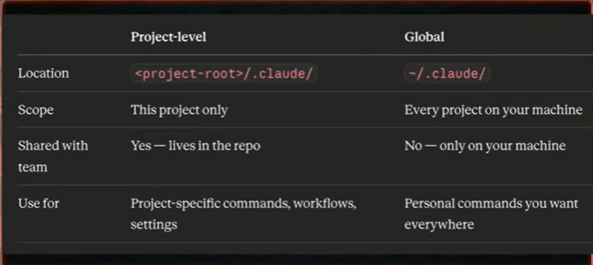

commands learnt
/resume - Select and resume a context, can also use `claude -r`
/model - View and change models during a session
/exit - Exit a session
/btw - Chats not taken into context, runs parallely to current tasks
/usage - Shows daily and weekly usage & limits
/stats - Shows useful usage beahviour statistics
/extra-usage - To top up when tokens run out
/insights - Provides html to improve your workflow, current project, usage etc. Nitish recommends this after 10 to 15 sessions
/config - Lets you tweak claude settings
/permissions - Allow, ask or deny permissions given to claude agent, read,write, terminal access etc.
/voice - Enable voice mode 
/rename <session name >
/usage
/context 
/compact - If the message context is react to 75% then better to run /compact
=============Context Windows++++++++++++++++=

one session per feature
use /compact when ut's required
Write focused, specific prompts
Use subagents for isolated or exploratory work
Use .claudeignore to keep Irrelevent Files out

=============claude.md==========
LLM dont' have memory
claude code can't remember things from prev session
Need to repeat acress every session 
Repeating instruction is cubersome & error prone
Leads to inconsistent code generation

claude.md file is a special project level instruction file used by claude code to guide how it behaves while working with codebase.

This of it is a persistent system prompt for your project.

## Instead of repeatedly telling claude:
How project is structured 
coding conventions
how to run/build/test
what tools to use

We put all of that into claude.md, clade automatically use it as context in every session.

use /init to generate Claude.md file

init command run agests to understand the full project structure and then put the details in Claude.md -> It created initial skelon after that we can edit based our requirements

## Content of claude
Project Context
Architecture
Code style
Preffered libraries
Commands
Critical Rules

## .claude folder
The .claude folder is claude ocde's local configuration directory that controls how claude code behaves  - either for a specific project or across all project on your machine.

It Store all config related info about skills, custom slash command, sub-agents etc.

### Two level of claude folder
Project level
Globa/user-level

### Types of claude.md
Project Root - ./CLAUDE.md

Inside .claude folder - ./.claude/CLAUDE.md

Local(personal, Fitignored) - ./CLAUDE.md

Create CLAUDE.local.md in your poject root. claude reads it alongside the main CLAUDE,ms and it's automatically gitignored so your personal tweaks never land in the repo.

Global- ~/.claude/CLUADE.md

YOur personal preference that apply across all projects thinking like your codings style default , preferred tools or general working style go here, This user-level file is available across all your project.

Subdirector - ./some/folder/CLAUDE.md

starting in the current working firectory, claude code recurses up to / and reads only any CLAUDE.md or CLAUDE.local.md files it finds.

This is especially required in big repositrues.

### Good practice
- start with /init, then prune aggressively(modify acccordingly to u)

Commit it to git

Only put universally applicatioble things in it

For critical rules use at start of stement use IMPORTANT[IF everything is IMPORTANT then nothing is] Use it wisely.

Don't cross more than 200 lines
- as instruction count increase, instructions following quality decreases.

Rule- Would removing this line from  claude .md is claude code can start behaving stange if not then we can remove it.

If claude.md file is getting increase in that case instead if writing everything in a single file keep .md in rules folder(.claude/rules/)

Use @imports to reference external docs

### Auto memory 
Auto memory is a persistent directory where claude records learnings, patterns and insights as it works.

When Claude discovers somethings about your project ("Oh, this appllications uses INR instead of USD") It saves that to auto memory. Next session it already knows about it. No more repeating yourself.

It lives in ~claude/projects/<project Name>/ memory/:

When the meory.md file increased then in the new session it only take first 200 lines information, so better to optimise in thise case

/memory -> prject meory and user memory will show

============== Spec-Driven Development in Claude Code ===============
## The problem with vibe coding

### First what is vibe coding - > 
It is modern warn style of programming where instead of carefully planning everything upfront, you build software by interacting with an AI assistance in a fast, conversational and experimental way.

The main problem - Amount of control

Example: Build a user auth system
- Which framework ?
- JWT or session
- WHat are the password rules
- What happens on 3 failed attempts

You get code fast,but it may not be the right code. you end up in a loop of correction and patchaces.

### Spec driven development

